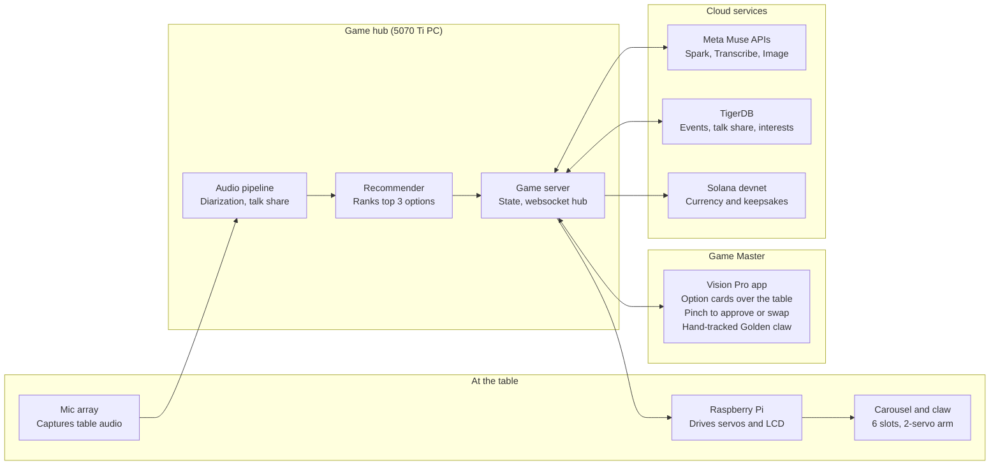

# Centerpiece: Project Spec

October 24, 2026 · Elijah Walker

## Pitch and feedback response

Centerpiece is a tabletop claw machine that runs a party game for a friend group, with an AI that reads the room and a human Game Master who makes the final calls. The AI listens for who is being left out and what the group has in common, then recommends a challenge and a target player. The Game Master, wearing the Vision Pro, approves or edits the pick, and the claw delivers the capsule to that player.

What changed after the pitch:

- **Ambition of execution.** The full XY gantry is cut. The claw becomes a turntable carousel plus one servo arm, which picks from fixed slots and is far more reliable. The custom turn-taking model is now a stretch goal; the MVP uses talk-time balance from diarization.
- **More entertaining than talking.** Capsules now hold challenges with a physical or competitive element: duels, bounties, team builds, and timed rounds, not only discussion prompts.
- **Human in the loop.** The AI recommends; the Game Master decides. The role rotates every round so no one sits behind a headset for long.
- **Stakes and keepsakes.** An in-game currency and collectible capsules on Solana devnet give the group a persistent score and something to keep after the night ends.

Submission closes Sunday, October 25 at 11:30 am CT. Teams are capped at 4 people under the official rules.

## Track alignment

The Meta rubric drives the design, because it weights human connection highest and the demo video is the whole submission. Weights below are from the HackTX official rules, which list Execution at 25%; the flyer says 20%.

| Track | What judges want | How Centerpiece answers it |
| --- | --- | --- |
| Meta: Human Connection (30%) | Real connection, not screen time | The game routes attention to quiet players and builds challenges from interests people share. Phones come out for one tap to open a capsule, then go back down. |
| Meta: AI Centrality (25%) | AI is core, not decorative | AI does diarization, interest extraction, challenge generation, and target recommendation. Without it there is no game. |
| Meta: Originality (20%) | Something new | A claw machine as a conversation facilitator, with a human Game Master approving AI picks. |
| Meta: Execution (25%) | Complete, convincing demo | Carousel claw instead of a gantry. One clean scripted round on video. |
| Hardware | Tangible, beyond the screen | Servo carousel and claw, Pi control loop, LCD face, mic array, Vision Pro hand-tracked override. |
| Jester | People won't put it down | Rounds, duels, bounties, streaks, rare capsules, a leaderboard that persists across game nights. |
| Solana (MLH) | Meaningful on-chain use | Devnet SPL token as the in-game currency; compressed NFTs as capsule keepsakes. |
| TigerDB (MLH) | Meaningful database use | Assumed to mean Tiger Data (TimescaleDB). Confirm with the sponsor. Hypertables for game events, pgvector for interests. |

Meta tools to use: Muse Spark for challenge generation and recommendations, Muse Voice Transcribe for transcription, Muse Image for capsule art, and a Muse connector that exposes group history and plans.

## Game loop

A game night is 4 to 6 rounds of about 5 minutes each, played by 3 to 6 people around one table. Scoring is mostly cooperative: the group fills a shared pot, and individuals earn bonus currency only from challenges that involve another person.

1. **Mingle (2 to 3 min).** Free conversation. The AI tracks talk-time balance per speaker and extracts topics and interests.
2. **Recommend.** The AI proposes its top 3 options, each a challenge type, a target player, and a one-line reason ("Maya has spoken 6% of the round; she and Jordan both mentioned climbing").
3. **Game Master decides.** The Vision Pro wearer sees the options anchored over the table, pinches to pick one, and can edit the prompt by voice or swap the target.
4. **Claw delivers.** The carousel rotates the chosen capsule slot to the arm, which grabs it and drops it in the delivery tray facing the target's seat. The target taps the capsule with their phone, and the page loads the challenge the Game Master assigned. The LCD announces it to the table.
5. **Play (60 to 90 s).** The LCD runs a timer. The mic and AI verify outcomes where they can.
6. **Payout.** Currency goes to the pot and to involved players. A capsule keepsake is minted when earned. The headset passes to the next Game Master.

### Capsule types

| Capsule | How it plays | What the AI does | Why it connects people |
| --- | --- | --- | --- |
| Duel | Two players get a this-or-that prompt and 30 s each to win over the table, which votes by hand | Picks two players with a real difference of opinion from the transcript | Turns disagreement into play |
| Bounty | The target gets a secret mission: learn one specific thing about another player before the round ends | Writes the bounty from gaps in what the group knows; checks the transcript to confirm it was found | Rewards asking real questions |
| Hot Seat | One player answers a personal question; everyone else writes their guess first | Writes the question from that player's stated interests | Pulls the quietest player into the center |
| Jinx | Everyone says their answer to a prompt on the count of 3 | Detects matching words in the audio; pays out per match | Fast, loud, and funny |
| Forge | Two players describe an imaginary object together for 45 s | Muse Image renders it; the image becomes the minted keepsake | A shared creation they keep |
| Golden | Rare. The Game Master pilots the claw by hand tracking to grab a bonus capsule | Hand-tracking to servo mapping | The headline demo moment |

### Capsule tags

Every capsule carries an identical adhesive NFC tag pointing at the same game URL, and the server decides what each tap shows. The capsules are interchangeable, so the carousel does not sort them by type.

- **One URL, one ID per tag.** Write `https://<game-domain>/c?t=07`, with a different `t` on each tag. The base URL is shared, but the server can tell capsules apart.
- **Assignment at delivery.** When the Game Master confirms a pick, the server binds the next capsule's tag ID to that round's challenge type, prompt, and target player.
- **Private by default.** The first tap from the target's checked-in phone claims the capsule. Anyone else who taps it sees only the public half, so Bounty missions stay secret.
- **Delivery proof.** The tap is logged to the `events` hypertable, which confirms the right person received the capsule and starts the round timer.
- **Keepsake link.** After the round, the same tag opens that round's minted keepsake, so the physical capsule stays meaningful after the night ends.

Use NTAG213 or NTAG215 stickers. Keep them off metal parts, and test that both iPhone and Android open the URL with a background tap and no app installed.

## System architecture

The game server on the 5070 Ti PC is the single hub: every device talks to it over one websocket, and it alone calls the cloud services.

Audio flows left to right into the hub; decisions flow from the AI to the Game Master and back; commands flow out to the Pi, which moves the claw. Raw audio never leaves the hub.

## Solana and TigerDB design

Solana holds what players keep and carry between game nights; TigerDB holds everything the AI reads to run the game.

### Solana (devnet only)

- **Currency.** An SPL token minted by a game authority keypair. Each player gets a custodial devnet wallet at check-in, claimable into Phantom later from the capsule page.
- **Shared pot.** A group wallet that collects cooperative payouts. The leaderboard reads balances directly from chain.
- **Keepsakes.** Compressed NFTs (Metaplex Bubblegum) minted for Forge creations, Golden capsules, and completed Bounties. Metadata holds the capsule type, round, involved players' display names, and the Muse Image art.
- **Guardrails.** Devnet only, no purchase, no cash-out. Say this in the video: a claw machine plus a token can read as gambling, and Meta judges will notice. Transcripts never go on chain.

### TigerDB (assumed Tiger Data / TimescaleDB)

| Table | Type | Holds | Used by |
| --- | --- | --- | --- |
| `events` | Hypertable | Speech segments, lulls, AI recommendations, Game Master choices, payouts, each timestamped per session | Recommender, recap, demo dashboard |
| `talk_share_1m` | Continuous aggregate | Talk share per player per minute | Target selection |
| `interests` | Table with pgvector | Interest embeddings per player | Shared-interest matching for Hot Seat and Forge |
| `players`, `sessions` | Tables | Display names, consent flags, wallet addresses | Check-in, payouts |

One metric worth showing judges: the Game Master acceptance rate, meaning how often the human took the AI's first pick. It proves the human-in-the-loop design is real.

### Privacy

The official rules bar collecting personal information without express written consent, so check-in includes a consent screen per player. Raw audio stays on the local machine. Only transcript text goes to Muse, and transcripts are deleted when the session ends.

## Scope

The MVP is one full round, played start to finish on camera, with every track touched once. Everything else is a stretch goal.

| Area | MVP (must work by 8 am) | Stretch | Fallback if it breaks |
| --- | --- | --- | --- |
| Claw | 6-slot servo carousel and a 2-servo arm dropping into one delivery tray | Tray rotates to face the target seat | Hand-load capsules and film only the carousel rotation |
| Audio | Laptop mic or USB array, diarization on the 5070 Ti box, talk share per speaker | Muse Voice Transcribe in real time; custom turn-taking model | Pre-recorded audio clip replayed through the pipeline |
| AI picks | Muse Spark returns top 3 options with reasons from transcript and interests | Bounty verification from transcript | Cached recommendations for the demo round |
| Vision Pro | Game Master sees 3 options anchored over an AprilTag and pinches to pick | Golden capsule hand-tracked claw control | Same UI on an iPad or laptop |
| Solana | Token payout and one cNFT mint per round on devnet | Phantom claim QR | Show the explorer page from an earlier successful run |
| TigerDB | `events` hypertable plus the `talk_share_1m` aggregate | pgvector interest matching, recap page | Local Postgres with the same schema |
| Meta extras | Muse Image for Forge art | Muse connector for group plans | Cut |

Cut entirely for this weekend: the XY gantry, on-Pi model inference, and the remote-player mode. Training on the 5070 Ti only stays if the core round works by midnight.

## Build timeline and team

Feature freeze is 8 am Sunday, submission is 11:00 am, and the last 30 minutes are buffer. Agree on the websocket message format by 5 pm so all four people can build against it in parallel.

| Person | Owns |
| --- | --- |
| 1. Hardware | Carousel and arm CAD and prints, servo control on the Pi, LCD screens, AprilTag mount |
| 2. AI and audio | Diarization pipeline, Muse Spark prompts for recommendations and challenges, Muse Image for Forge |
| 3. Vision Pro | visionOS Game Master app, anchored option cards, pinch selection, hand-tracking claw control |
| 4. Backend and data | Game state server, websocket hub, TigerDB schema, Solana token and cNFT minting, repo and README |

| Time (CT) | Milestone |
| --- | --- |
| Sat 4 to 5 pm | Start prints. Agree on message format. Stand up Tiger, devnet token, and repo |
| Sat 8 pm | Integration 1: a hard-coded recommendation reaches the Vision Pro, a pinch moves the carousel |
| Sat 11:59 pm | Integration 2: a full round with live audio, real AI picks, and a payout. Go or no-go on stretch goals |
| Sun 12 to 5 am | Stretch goals and reliability fixes. Sleep in shifts |
| Sun 8 am | Feature freeze. Rehearse the demo round 3 times |
| Sun 8 to 10 am | Film the demo video |
| Sun 10 to 11 am | Edit the video, make the repo public, write the description |
| Sun 11:00 am | Submit on hacktx.com |

## Demo video script

The video follows Meta's suggested breakdown and runs 2:45, leaving 15 seconds of margin under the 3-minute cap.

| Time | Segment | On screen |
| --- | --- | --- |
| 0:00 to 0:30 | Problem | Friends at a table, half on their phones, one person silent. Voiceover: group hangouts default to screens and the same two talkers. |
| 0:30 to 2:00 | Working demo | One full round: mingle, the Vision Pro view of 3 AI options with reasons, the Game Master's pinch, the claw delivering to the quiet player, a Jinx or Duel played out, the payout and minted keepsake. Cut to a Golden capsule hand-tracked grab. |
| 2:00 to 2:30 | How AI works | Split screen: live diarization bars, the Muse Spark recommendation with its reasoning, the Game Master acceptance rate from TigerDB. |
| 2:30 to 2:45 | Tools and models | Muse Spark, Muse Voice Transcribe, Muse Image, Solana devnet, TigerDB, Raspberry Pi, Vision Pro, 5070 Ti. Name the AI coding tools you used to build it. |

Film with the real group at a real table, in a quiet room. Record the Vision Pro view separately and composite it in.
